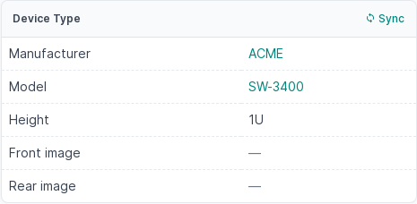
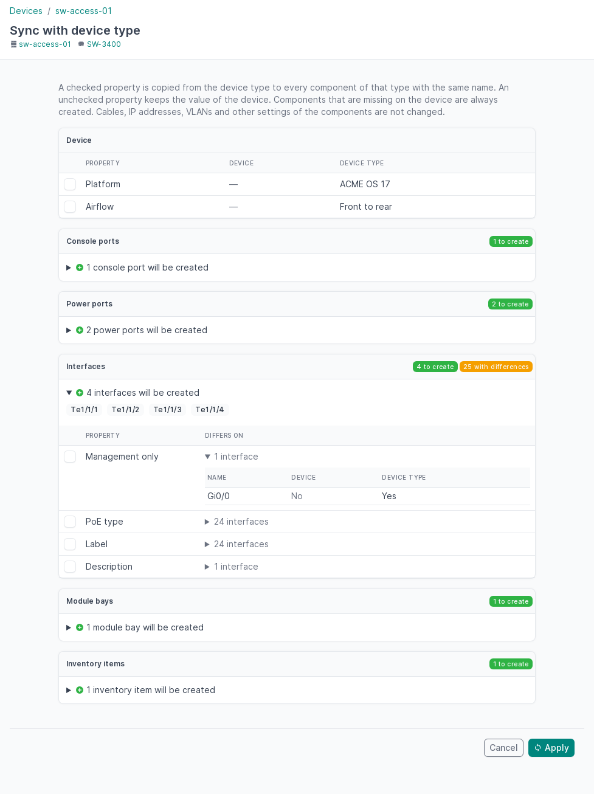

# NetBox Device Type Sync

A [NetBox](https://github.com/netbox-community/netbox) plugin that brings the
components of a device in line with its device type.

## Table of Contents

- [Purpose](#purpose)
- [How it works](#how-it-works)
- [What is synchronized](#what-is-synchronized)
- [How components are created and updated](#how-components-are-created-and-updated)
- [Permissions](#permissions)
- [Compatibility](#compatibility)
- [Installation](#installation)
- [Troubleshooting](#troubleshooting)
- [Limitations](#limitations)
- [Development](#development)
- [License](#license)

## Purpose

NetBox creates the components of a device (interfaces, ports, bays and so on)
from its device type only once, when the device is created. Later changes do
not reach the device:

- **A device is replaced by another model.** After you change the device type
  of the device, its components still have the names, types and settings of
  the old model.
- **A component is added to a device type.** Existing devices of that type do
  not get it.

Deleting and recreating the device would lose its cables, IP addresses, VLANs
and other settings. This plugin updates the device in place instead.

[⬆ Back to ToC](#table-of-contents)

## How it works

1. To replace a device, edit it and change its device type first. Then, on the
   Device page, click **Sync** in the header of the *Device Type* card.

    

2. The plugin compares the component templates of the device type with the
   components of the device that have the same name, and shows:
   - the device fields that NetBox copies from the device type only when a
     device is created (platform, airflow, cooling method);
   - for each component type, the components that exist in the device type
     but not on the device — they will be created;
   - for each component type, the properties that differ. Each property has a
     checkbox; expand a property to see the value on the device and in the
     device type for every component it differs on.

    

3. Check the properties to copy from the device type and click **Apply**.
   - A checked property is copied to every component of that type with the
     same name.
   - An unchecked property keeps the value of the device.
   - All checkboxes are unchecked by default: if you check nothing, only the
     missing components are created.

All changes are made in one transaction. If any component fails validation,
nothing is changed and the page lists the errors. Every change is recorded in
the NetBox change log with the message `Synced with device type <name>`.

[⬆ Back to ToC](#table-of-contents)

## What is synchronized

Only the properties that a component template defines are compared:

| Component | Properties |
| --- | --- |
| Console port, console server port | type, label, description |
| Power port | type, maximum draw, allocated draw, label, description |
| Power outlet | type, color, power port, feed leg, label, description |
| Cooling intake | type, diameter, maximum flow, label, description |
| Cooling outflow | type, diameter, cooling intake, label, description |
| Interface | type, enabled, management only, PoE mode, PoE type, wireless role, channels, channel ID, parent, bridge, label, description |
| Rear port | type, color, positions, label, description |
| Front port | type, color, positions, port mappings, label, description |
| Module bay | position, enabled, module bay types, label, description |
| Device bay | enabled, label, description |
| Inventory item | parent, component, role, manufacturer, part ID, label, description |

Device fields: **platform** (from the default platform of the device type),
**airflow** and **cooling method**. NetBox copies them from the device type
only when a device is created. A field is offered only when the device type
has a value and it differs from the device.

**Never changed:**

- cables, IP addresses, VLANs, MAC addresses, VRFs, MTU, mode, custom fields
  and tags of components — a device type does not define them;
- components installed by modules;
- components that exist on the device but not in the device type;
- device fields other than the three above. Height, weight, full depth and
  images are not stored on the device; NetBox always shows them from the
  device type.

[⬆ Back to ToC](#table-of-contents)

## How components are created and updated

- **Matching.** A device component matches a template with the same name.
  Names with `{vc_position}` are resolved for the virtual chassis position of
  the device. Inventory items are matched by their name and the names of their
  parents.
- **New components** are created from the template the same way NetBox
  creates them for a new device, including custom field defaults, interface
  parents and bridges, power outlet power ports, front/rear port mappings and
  module bay types. Like NetBox, the plugin does not copy the description of
  the template to a new component; select *Description* on a later sync to
  copy it.
- **Name conflicts.** If the name of a template is used by a component of an
  installed module, the component is not created and the page shows a
  warning.
- **Validation.** Every component is validated by NetBox before it is saved.
  For example, an interface with a cable cannot become a virtual interface:
  remove the cable or leave *Type* unchecked.
- **Inventory items** are deprecated since NetBox 4.3 and planned for removal.
  The plugin syncs them while NetBox has them.

[⬆ Back to ToC](#table-of-contents)

## Permissions

- The **Sync** button and the sync page require the permission to change the
  device (`dcim.change_device`), including any constraints of the object
  permission.
- **Apply** additionally requires the permission to add the components that
  are created and to change the components that are updated (for example
  `dcim.add_interface`, `dcim.change_interface`). If a permission is missing,
  nothing is changed and the page names the component.

[⬆ Back to ToC](#table-of-contents)

## Compatibility

| NetBox | netbox-device-type-sync |
| ------ | ----------------------- |
| 4.7.4  | 0.1.0                   |

Every NetBox version in this table has been tested with the plugin. Versions
that are not listed are not guaranteed to work: the Sync button relies on the
internal structure of the NetBox Device page (see
[Limitations](#limitations)).

NetBox 4.7 requires Python 3.12 or later, PostgreSQL 15 or later and Redis 6
or later.

[⬆ Back to ToC](#table-of-contents)

## Installation

1. Install the package into the NetBox virtual environment:

    ```bash
    source /opt/netbox/venv/bin/activate
    pip install netbox-device-type-sync
    ```

    To keep the plugin across NetBox upgrades, add it to
    `/opt/netbox/local_requirements.txt`:

    ```bash
    echo netbox-device-type-sync >> /opt/netbox/local_requirements.txt
    ```

2. Enable the plugin in `/opt/netbox/netbox/netbox/configuration.py`:

    ```python
    PLUGINS = [
        'netbox_device_type_sync',
    ]
    ```

3. Restart NetBox:

    ```bash
    sudo systemctl restart netbox netbox-rq
    ```

The plugin has no settings and no database tables.

[⬆ Back to ToC](#table-of-contents)

## Troubleshooting

**The Sync button is missing.**

- The button is shown only to users who may change the device.
- If nobody sees it, the plugin could not find the *Device Type* card in this
  NetBox version. The plugin then logs a warning to the logger
  `netbox.plugins.netbox_device_type_sync` when NetBox starts. With the
  default NetBox logging configuration the warning goes to the journal of the
  NetBox service:

    ```bash
    sudo journalctl -u netbox | grep netbox_device_type_sync
    ```

    The sync page itself still works:
    `/plugins/device-type-sync/devices/<device ID>/sync/`.

**Apply shows errors.** Nothing was changed. Each error names the component
and the reason given by NetBox. Fix the component or leave the property
unchecked, then apply again.

[⬆ Back to ToC](#table-of-contents)

## Limitations

- **The Sync button relies on NetBox internals.** NetBox has no plugin API to
  add a button to a built-in card. The plugin adds the button to the
  *Device Type* card of the Device page when NetBox starts. If a NetBox
  version changes that card, the button is not shown (see
  [Troubleshooting](#troubleshooting)); NetBox itself keeps working.
- **Components are matched by name.** A component that was renamed in the new
  device type (for example `GigabitEthernet1/0/1` → `TenGigabitEthernet1/0/1`)
  is treated as a new component; the old one, with its cable and IP
  addresses, is left as it is.
- **Devices only.** Modules are not synced with their module types.

[⬆ Back to ToC](#table-of-contents)

## Development

The tests run against a NetBox source checkout; see *Local test environment*
in [CLAUDE.md](CLAUDE.md) for the setup. Run them from the NetBox directory:

```bash
python netbox/manage.py test netbox_device_type_sync.tests --parallel
```

[⬆ Back to ToC](#table-of-contents)

## License

[MIT](LICENSE)

[⬆ Back to ToC](#table-of-contents)
